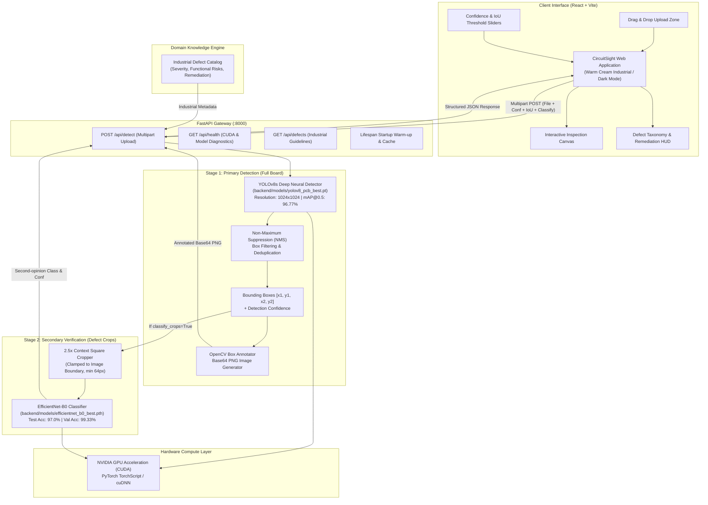

# CircuitSight - Automated Optical Inspection (AOI) Deep Learning System

[](https://fastapi.tiangolo.com)
[](https://pytorch.org)
[](https://github.com/ultralytics/ultralytics)
[](https://react.dev)
[](https://vitejs.dev)
[](https://tailwindcss.com)
[](https://developer.nvidia.com/cuda-zone)

**CircuitSight** is an industrial-grade **Automated Optical Inspection (AOI)** deep learning platform designed for real-time localization, classification, and engineering remediation of Printed Circuit Board (PCB) manufacturing defects.

Powered by a **two-stage architecture**:
1. **Primary Stage (Localization)**: A fine-tuned **YOLOv8s** object detector trained on full-board images that locates microscopic PCB defects with **96.77% mAP@0.5**.
2. **Secondary Stage (Verification)**: An ImageNet fine-tuned **EfficientNet-B0** classifier that inspects 2.5x context defect crops with **97.0% Test Accuracy (99.33% Val Accuracy)**.

---

## 🏛️ System Architecture



---

## 📊 Model Performance & Benchmarks

Both models are evaluated on unseen boards adhering to strict board-level split isolation (ensuring no photo of the same PCB exists across train and test sets).

### 1. Stage 1: YOLOv8s Object Detector
* **Trained Weights**: `backend/models/yolov8_pcb_best.pt`
* **Input Resolution**: `1024x1024 px`
* **Inference Latency**: `~49.6 ms` (CUDA)
* **Model Size**: `21.51 MB`

| Metric | Score |
|---|---|
| **mAP@0.5 (Overall)** | **96.77%** |
| **mAP@0.5:0.95 (Strict)** | **49.74%** |
| **Precision** | **85.83%** |
| **Recall** | **89.73%** |

#### Per-Class Detection AP@0.5:
* **Missing Hole / Via**: `98.75%`
* **Mouse Bite**: `98.25%`
* **Open Circuit**: `99.46%`
* **Short Circuit**: `89.21%`
* **Spur**: `96.79%`
* **Spurious Copper**: `98.17%`

---

### 2. Stage 2: EfficientNet-B0 Crop Classifier
* **Trained Weights**: `backend/models/efficientnet_b0_best.pth`
* **Input Resolution**: `224x224 px` (with 2.5x spatial context around bounding box)
* **Inference Latency**: `~0.52 ms` (CUDA)
* **Model Size**: `15.61 MB`

| Metric | Score |
|---|---|
| **Test Accuracy** | **97.00%** |
| **Best Validation Accuracy** | **99.33%** |
| **Weighted Precision** | **97.06%** |
| **Weighted Recall** | **97.00%** |
| **Weighted F1-Score** | **0.9701** |

---

## 🏷️ Supported Defect Taxonomy

CircuitSight classifies defects into 6 critical IPC-A-610 manufacturing categories:

| Defect Class | Severity | Description | Functional Risk | Factory Remediation |
|---|---|---|---|---|
| **`missing_hole`** | `High` | Absence of a drilled component lead hole or conductive through-hole via. | Pins cannot be mounted; multi-layer electrical connectivity broken. | Audit drill CNC program and bit breakage detector. Re-drill or scrap. |
| **`mouse_bite`** | `Medium` | Ragged erosion or bite along trace edges or board boundaries. | Weakens trace mechanical strength; localized impedance spikes under high current. | Inspect photoresist adhesion and chemical etching uniformity. |
| **`open_circuit`** | `Critical` | Complete physical discontinuity along a conductive copper trace. | Complete signal or power loss; immediate system failure. | Micro-wire rework for prototypes; audit photolithography mask clarity. |
| **`short`** | `Critical` | Accidental conductive copper bridge connecting two distinct traces/pads. | Thermal runaway, power supply shutdown, component burnout. | Precision laser de-bridging; audit exposure alignment and rinse stages. |
| **`spur`** | `Medium` | Sharp copper protrusion extending outward from a trace without bridging. | Reduced dielectric creepage; high risk of arcing and capacitive noise. | Clean optical artwork; verify etching bath temperature and agitation. |
| **`spurious_copper`** | `Low-Med` | Isolated islands or specks of un-etched residual copper on substrate. | Intermittent shorts under vibration; unwanted stray capacitance. | Adjust copper etchant chemistry and laminator cleanliness. |

---

## 🚀 Getting Started

### Prerequisites
* **Python 3.10+** (Virtual environment recommended)
* **Node.js 18+** & **npm**
* **NVIDIA GPU** with CUDA support (CPU fallback fully supported)

---

### 1. Backend Setup (FastAPI)

1. Navigate to the backend directory:
   ```bash
   cd backend
   ```

2. Activate your virtual environment:
   ```bash
   # Windows PowerShell
   ..\venv\Scripts\Activate.ps1

   # Windows Command Prompt
   ..\venv\Scripts\activate.bat
   ```

3. Launch the FastAPI server:
   ```bash
   python -m uvicorn main:app --host 127.0.0.1 --port 8000 --reload
   ```

4. Verify server status:
   * **Swagger Documentation**: [http://127.0.0.1:8000/docs](http://127.0.0.1:8000/docs)
   * **ReDoc Documentation**: [http://127.0.0.1:8000/redoc](http://127.0.0.1:8000/redoc)
   * **Health Check**: [http://127.0.0.1:8000/api/health](http://127.0.0.1:8000/api/health)

---

### 2. Frontend Setup (React + Vite)

1. Open a new terminal and navigate to the frontend directory:
   ```bash
   cd frontend
   ```

2. Install dependencies:
   ```bash
   npm install
   ```

3. Start the Vite development server:
   ```bash
   npm run dev
   ```

4. Open your browser and navigate to **[http://localhost:5173](http://localhost:5173)**.

---

## 📡 REST API Reference

### 1. `POST /api/detect`
Performs YOLOv8 multi-defect localization on a full PCB image.

* **Content-Type**: `multipart/form-data`
* **Parameters**:
  * `file` *(UploadFile, required)*: PCB image file (`.png`, `.jpg`, `.bmp`, `.webp`)
  * `conf` *(float, optional)*: Confidence threshold (`0.01` to `0.99`, default: `0.25`). Values `<= 0` fall back to `0.25`.
  * `iou` *(float, optional)*: Non-Maximum Suppression IoU threshold (`0.01` to `0.99`, default: `0.45`).
  * `imgsz` *(int, optional)*: Image resolution for YOLO inference (default: `1024`).
  * `classify_crops` *(bool, optional)*: Enables secondary EfficientNet-B0 classification on 2.5x context crops (default: `false`).
  * `include_annotated_image` *(bool, optional)*: Returns a base64-encoded PNG image with bounding boxes drawn (default: `false`).

#### Example Request (`curl`):
```bash
curl -X POST "http://127.0.0.1:8000/api/detect" \
  -F "file=@backend/dataset/PCB_DATASET/images/Missing_hole/01_missing_hole_01.jpg" \
  -F "conf=0.25" \
  -F "classify_crops=true" \
  -F "include_annotated_image=true"
```

#### Example Response:
```json
{
  "success": true,
  "image_width": 3034,
  "image_height": 1586,
  "total_defects": 3,
  "defect_summary": {
    "missing_hole": 3
  },
  "detections": [
    {
      "class_name": "missing_hole",
      "confidence": 0.818,
      "bbox": [1616, 340, 1676, 398],
      "defect_details": {
        "name": "Missing Hole / Missing Via",
        "severity": "High",
        "description": "A required drilled component lead hole or conductive through-hole via is absent on the PCB.",
        "risk": "Component pins cannot be inserted; electrical layer-to-layer connectivity is broken.",
        "remediation": "Check drill CNC program and drill bit breakage detection. Re-drill if board unplated, or scrap board."
      },
      "classifier_class": "missing_hole",
      "classifier_confidence": 0.99999
    }
  ],
  "inference_time_ms": 136.5,
  "model_name": "yolov8s",
  "device": "cuda",
  "warning": null,
  "annotated_image_base64": "iVBORw0KGgo...",
  "settings_used": {
    "conf": 0.25,
    "iou": 0.45,
    "imgsz": 1024
  }
}
```

---

### 2. `GET /api/defects`
Returns industrial taxonomy, descriptions, and remediations for all 6 supported defect types.

### 3. `GET /api/defects/{class_name}`
Returns detailed engineering guidelines for a specific defect class.

### 4. `GET /api/health`
Returns live operational diagnostics, GPU acceleration status, and model lifecycle information:
```json
{
  "status": "healthy",
  "device": "cuda",
  "cuda_available": true,
  "gpu_name": "NVIDIA GeForce RTX 4060 Laptop GPU",
  "active_model": "yolov8s",
  "checkpoint": "yolov8_pcb_best.pt",
  "supported_classes": [
    "missing_hole", "mouse_bite", "open_circuit", "short", "spur", "spurious_copper"
  ],
  "detector": {
    "loaded": true,
    "model_name": "yolov8s",
    "model_path": "yolov8_pcb_best.pt",
    "classes": ["missing_hole", "mouse_bite", "open_circuit", "short", "spur", "spurious_copper"],
    "device": "cuda",
    "map50": 0.9677,
    "map50_95": 0.4974
  },
  "classifier": {
    "loaded": true,
    "model_name": "efficientnet_b0",
    "model_path": "efficientnet_b0_best.pth",
    "device": "cuda"
  }
}
```

---

## 🧪 Automated Test Suite

A complete test suite is provided in `backend/test_detect_endpoint.py`. To execute all unit and integration tests:

```bash
cd backend
python test_detect_endpoint.py
```

**Test Coverage Highlights**:
- Lifespan warm-up & CUDA memory allocation
- Full board detection on sample PCB photos
- Zero-detection policy validation (`conf=0.99`) with safety warning
- Two-stage crop classification (`classify_crops=true`)
- Base64 PNG image decoding and signature verification
- Non-image rejection (`400 Bad Request`)
- Large file rejection (`413 Request Entity Too Large`)
- Low-resolution warning (< 800px input)
- Confirm legacy routes return `404 Not Found`

---

## 📂 Project Structure

```
CircuitSight/
├── .gitignore                      # Git exclusion rules
├── README.md                       # System documentation & architecture
├── build_dataset.py                # Dataset extraction and board-level split builder
├── backend/
│   ├── main.py                     # FastAPI application setup and lifespan
│   ├── schemas.py                  # Pydantic request/response schemas
│   ├── prediction.py               # Crop classification engine & Grad-CAM
│   ├── test_detect_endpoint.py     # Automated test suite
│   ├── requirements.txt            # Python dependencies
│   ├── api/
│   │   ├── deps.py                 # DetectorManager & ModelManager singletons
│   │   ├── routes_detect.py        # POST /api/detect (YOLOv8 + crops)
│   │   ├── routes_defects.py       # GET /api/defects (Defect catalog)
│   │   └── routes_health.py        # GET /api/health (System status)
│   ├── models/
│   │   ├── yolov8_pcb_best.pt      # Fine-tuned YOLOv8s detector checkpoint
│   │   ├── yolov8_pcb_best.json    # Detector validation metrics & classes
│   │   ├── efficientnet_b0_best.pth# Fine-tuned EfficientNet-B0 checkpoint
│   │   └── resnet50_best.pth       # Alternative backbone checkpoint
│   ├── notebooks/
│   │   ├── yolov8_pcb_detection.ipynb      # YOLOv8 training & evaluation
│   │   └── efficientnet_b0_training.ipynb  # EfficientNet-B0 training
│   └── results/
│       ├── yolov8/                 # PR curves, confusion matrices, metrics
│       └── efficientnet_b0/        # Classifier confusion matrix & summaries
└── frontend/
    ├── package.json                # Frontend dependencies
    ├── vite.config.js              # Vite configuration & /api proxy
    └── src/
        ├── App.jsx                 # CircuitSight React UI (Warm Cream / Dark Mode)
        ├── CircuitSightApp.jsx     # Reusable standalone component export
        └── index.css               # Tailwind CSS & custom animations
```


---

## ⚖️ License & Ethics Note
CircuitSight is developed for educational and industrial quality assurance research. Inspection outputs provide statistical inference assistance and should be verified against IPC-A-610 standards by certified quality control personnel.
